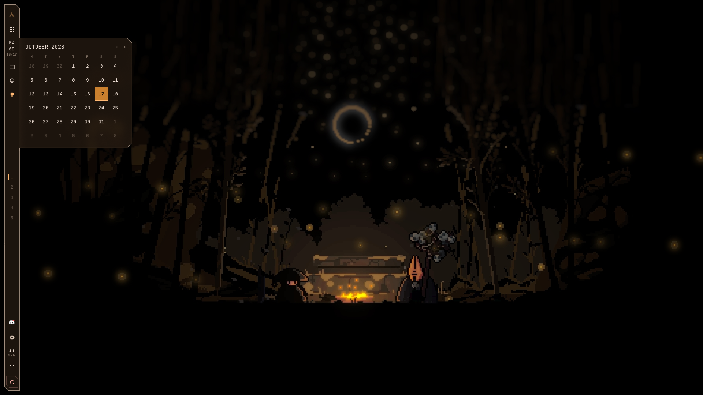
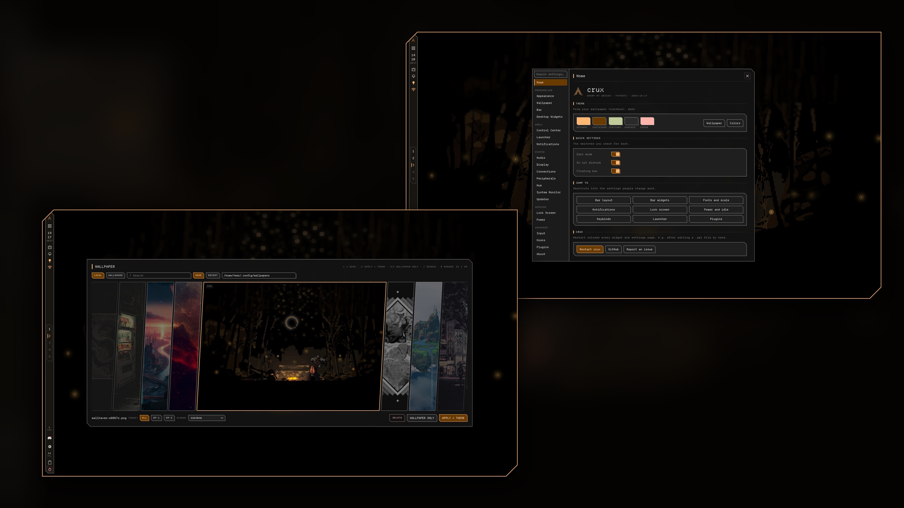

<div align="center">

# crux



<h4>Sharp by design.</h4>


 <br>

[](https://0ver.org)

</div>

> [!WARNING]
> This is my personal daily driver. It changes under me without warning, and every corner gets chamfered whether you like it or not.

> [!TIP]
> Everything's configurable from the settings panel: a home page with your theme, quick toggles and shortcuts, 20 tabs in five sections, and a search box so you don't have to remember where anything lives.

## Features

**Bar**
- Sits on any edge, set per monitor, as a docked strip or a floating outlined pill
- 37 widgets: workspaces, clock, media, tray, audio, network, Bluetooth, battery, system stats, updates and more
- Long-press and drag to reorder widgets, including between sections
- Click a widget and its drawer opens joined to the bar's outline; on a floating bar it unfolds straight out of the widget
- A wallpaper backdrop behind the bar hides windows that a scrolling layout parks off-screen, fading out toward the work area

**Desktop**
- Control Center with quick toggles, audio sliders, weather, system gauges, and capture, record and color-pick actions
- App launcher with fuzzy search, a run-command prefix and an inline calculator (press Enter to copy the result)
- Notifications with history and do-not-disturb, a volume OSD, a session menu
- Lock screen, polkit agent and idle handling (screen off, lock, suspend), all built in
- Night light, clipboard history and Philips Hue control

**Theming**
- Wallpaper browser: your local folder as a strip of slanted slices, Wallhaven search as a grid
- Pick a wallpaper and crux generates a palette from it with matugen, in light or dark
- Or pick a preset: Ayu, Catppuccin, Dracula, Eldritch, Everforest, Gruvbox, Kanagawa, Mocha, Nord, Rosé Pine, Tokyo Night
- The palette is pushed into Hyprland, kitty, GTK, Qt, yazi, btop, starship and Discord (Vesktop, BetterDiscord)
- Windows get chamfered corners to match, through Hyprland shader overrides. Pick which corners are cut in Appearance settings

<div align="center">

</div>

## Requirements

- [Hyprland](https://hyprland.org) with a **Lua config** (`hyprland.lua`). crux talks to Hyprland in Lua dispatch syntax, so a classic `hyprland.conf` setup can't switch workspaces from the bar
- [Quickshell](https://quickshell.org)
- `matugen`, `brightnessctl`, `wlsunset`, `cliphist`, `wl-clipboard`, `playerctl`, `networkmanager`, `bluez`, `python`, `git`

Optional:

| Package | For |
| --- | --- |
| `lm_sensors` | CPU temperature in the Control Center |
| `wf-recorder` | The Control Center's record action |
| `hyprpicker` | The Control Center's color picker |
| `imagemagick` | Small cached thumbnails, so the wallpaper browser opens fast |
| `kitty`, `gtk3`, `gtk4`, `qt6ct`, `yazi`, `btop`, `starship`, `vesktop` | Theming those apps from your wallpaper |

## Install

**Arch (AUR):**

```sh
yay -S crux-shell-git
qs -c crux
```

**Manual:**

```sh
git clone https://github.com/teezlabs/crux-shell ~/.config/quickshell/crux
qs -c crux
```

To start it with Hyprland, add this to your Lua config:

```lua
hl.on("hyprland.start", function()
    hl.exec_cmd("qs -c crux")
end)
```

## Keybinds

Everything crux opens can be driven from a keybind through Quickshell's IPC:

```sh
qs ipc -c crux call launcher toggle
qs ipc -c crux call controlCenter toggle
qs ipc -c crux call settings toggle
qs ipc -c crux call wallpaperBrowser toggle
qs ipc -c crux call lockscreen lock
qs ipc -c crux call darkMode toggle
qs ipc -c crux call volume increase
```

Each of these opens on whichever monitor has focus. `qs ipc -c crux show` lists every target.

## Configuration

Settings live in `~/.config/crux/settings.json`, but you shouldn't need to touch it: everything is in the settings panel.

**Color presets:** drop a JSON file into `Assets/ColorSchemes/` and it shows up in the picker. Copy one of the existing files to see the format.

**kitty:** add `include themes/crux.conf` to `~/.config/kitty/kitty.conf`, after any other theme include. Open kitty windows reload when the wallpaper changes.

**Window corners:** the size of the cut follows Hyprland's `decoration:rounding` (`rounding = 30` cuts about 14px), so set it above 0. Turning window corners off in Appearance settings restores Hyprland's stock shaders.

**Plugins:** put a `manifest.json` and a `Widget.qml` in `~/.config/crux/plugins/<name>/`. That's it, no marketplace.

<div align="center">

<sub>made with ~~Claude~~ love</sub>

</div>
